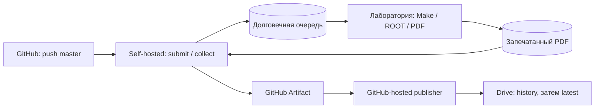

# Расчёт на лабораторном ПК и публикация PDF

Этот набор подготовлен локально. Лабораторный ПК пока не обследован, runner и
службы на нём не установлены, вход в Google Drive и настоящая публикация не
выполнялись. Текущая рабочая среда — macOS; приведённая установка рассчитана
только на подтверждённый аудитом **Linux с systemd**.

После push в `master` или ручного запуска [workflow](../.github/workflows/lab-compute.yml)
короткий self-hosted job сохраняет точный SHA с подмодулями и ставит расчёт в
локальную очередь. Пользовательская systemd-служба выполняет его независимо от
Actions. Collector передаёт готовый PDF в GitHub Artifact, а отдельный
**GitHub-hosted** job публикует его в Drive. Google credentials на лабораторный
ПК не передаются. Docker, входящий SSH и постоянно открытый HTTP-сервер не нужны.



По умолчанию обрабатываются `config/kt.json` и `config/y.json`. Для каждого
строятся презентация со всеми доступными графиками (`PRESENTATION_PLOTS=0`) и
полный `manual_chi2.C`-отчёт; Ghostscript объединяет их в `report.pdf`.
Исходные конфиги не меняются: абсолютные пути вывода, число потоков и сохранение
изображений задаются копиям внутри отдельной попытки расчёта. Нативные графики
сравнения ROOT/manual χ² входят в зависимости расчёта и его презентацию.

| Локальное состояние | Значение |
| --- | --- |
| `queued` | Исходники сохранены, задание ожидает worker |
| `building` | Проверяются инструменты и собирается программа |
| `running` | Выполняются анализ и сборка PDF |
| `uploading` | Свежий PDF проверен и ожидает публикации либо уже передаётся |
| `success` | Publisher подтвердил сохранение в Drive |
| `failed` | Ошибка этапа, остановка оператором или ошибка загрузки; причина сохранена |

Зелёный короткий job при push означает принятие задания, а не успешное завершение
научного расчёта. Его состояние видно в следующих `status`/плановых workflow и
в локальном `job.json`. С `permissions: contents: read` worker не меняет GitHub
commit statuses и checks. Collector запускается примерно каждые 15 минут;
[GitHub schedule](https://docs.github.com/en/actions/reference/workflows-and-actions/events-that-trigger-workflows#schedule)
работает по возможности и не даёт гарантии времени доставки.

1. Администратор подтверждает политику лаборатории: разрешён ли self-hosted
   runner, исходящий HTTPS к GitHub/Actions и передача отчётов в Google Drive.
   Выделяется обычная учётная запись, например `cf-lab`, без административных
   прав и без доступа к чужим ключам и данным. Доступные ей исходные ROOT-файлы
   должны быть согласованы с владельцем данных.

   На реальном ПК следует проверить ОС, архитектуру, systemd user manager,
   свободный диск, права на входные файлы и версии Python, Git, CMake, C++, ROOT,
   OpenSSL и инструментов PDF. Нужен Python 3.9 или новее. Для документов нужны
   XeLaTeX, latexmk, Biber и Ghostscript; дополнительные зависимости описаны в
   [инструкции документов](thesis/README.md). Go нужен при пересборке сборщика
   презентации, если готовый бинарный файл для архитектуры не используется.
   Аудит не устанавливает пакеты и не исправляет системные настройки.

2. Под этой учётной записью создайте внешнюю конфигурацию из
   [примера](../tools/lab_automation/config.example.json):

   ```bash
   umask 077
   mkdir -p "$HOME/.config/cf-maker-lab"
   cp tools/lab_automation/config.example.json "$HOME/.config/cf-maker-lab/config.json"
   chmod 600 "$HOME/.config/cf-maker-lab/config.json"
   export CF_LAB_CONFIG="$HOME/.config/cf-maker-lab/config.json"
   ```

   Замените `state_dir` на отдельную абсолютную директорию вне checkout, например
   `/home/cf-lab/.local/state/cf-maker-lab`. Она содержит очередь, снимки исходников,
   состояния, попытки и логи и должна иметь права `0700`. `config_files` задаёт
   относительные пути конфигов репозитория; `input_root` при необходимости заменяет
   их `machine.base_input`. `setup_script` — абсолютный путь доверенного скрипта
   активации предустановленного ROOT. Укажите реальные `tools`, `cxx`, `jobs` и
   `threads`, учитывая загрузку общего ПК. Секретов в этом JSON нет.

   Активируйте рабочее окружение и выполните аудит из доверенного checkout:

   ```bash
   python3 tools/lab_automation/audit.py --config "$CF_LAB_CONFIG" --source "$PWD"
   ```

   После согласования сети отдельно добавьте `--network --policy-confirmed`.
   Эти проверки не используют авторизацию и не публикуют данные. Флаг
   `--policy-confirmed` записывает утверждение оператора; он не доказывает наличие
   разрешения администратора. Неуспешный аудит требует разбора до установки.

3. Только для проверенного Linux/systemd администратор один раз включает запуск
   пользовательских служб после logout и reboot:

   ```bash
   sudo loginctl enable-linger cf-lab
   ```

   Затем сам пользователь, **без sudo**, устанавливает worker:

   ```bash
   bash tools/lab_automation/install-linux.sh --config "$CF_LAB_CONFIG"
   systemctl --user status cf-maker-worker.path cf-maker-worker.service
   ```

   Installer проверяет Linux, непривилегированный UID, user bus и linger,
   копирует `lab.py` и `audit.py` вне checkout и устанавливает два пользовательских
   unit-файла. Код и каталоги получают `0700`, конфиг и unit-файлы — `0600`.
   По умолчанию код находится в `$XDG_DATA_HOME/cf-maker-lab` либо
   `$HOME/.local/share/cf-maker-lab`; можно передать `--install-dir`.
   Директории кода и состояния должны быть разными. Для unit-шаблонов не
   поддерживаются пути с управляющими символами, `%`, `$`, кавычкой и `\`.
   Installer не регистрирует runner, не включает linger и не получает Drive tokens.

   `.path` следит за `state_dir/queue`, а `.service` исполняет очередь без
   ограничения времени запуска. Однократный запуск service при boot также
   восстанавливает незавершённые записи. Состояние и очередь сохраняются на диске,
   доступ к ним сериализуется файловыми блокировками и атомарными записями.

4. В GitHub откройте **Settings → Actions → Runners → New self-hosted runner**
   и выберите фактические ОС и архитектуру. Выполните показанную регистрацию под
   выделенной учётной записью с дополнительной меткой `cf-maker-lab`. Используйте
   временный registration token; постоянный PAT в workflow не нужен. Для Linux
   администратор может установить стандартную службу runner с исполнением под
   `cf-lab` через `svc.sh install cf-lab` и `svc.sh start` из каталога runner.
   Эти административные действия выполняются однократно, не из workflow.
   [Официальная инструкция службы runner](https://docs.github.com/en/actions/how-tos/manage-runners/self-hosted-runners/configure-the-application).

   Runner должен принадлежать только доверенному репозиторию. Репозиторий должен
   быть приватным: постоянный self-hosted хост не изолирует произвольный код.
   В **Settings → Rules → Rulesets** защитите `master`: запретите force push и
   удаление, ограничьте прямую запись и требуйте проверку изменений workflow и
   automation-кода. Если runner groups доступны в вашей организации, разрешите
   только `OWNER/REPO/.github/workflows/lab-compute.yml@refs/heads/master`.
   [Риски self-hosted runners](https://docs.github.com/en/actions/reference/security/secure-use#hardening-for-self-hosted-runners),
   [ограничение доступа групп](https://docs.github.com/en/enterprise-cloud@latest/actions/how-tos/manage-runners/self-hosted-runners/manage-access).

   В репозитории создайте Actions variables:

   | Variable | Значение |
   | --- | --- |
   | `CF_LAB_REPOSITORY` | Точное `OWNER/REPO` этого репозитория |
   | `CF_LAB_CONFIG` | Абсолютный путь внешнего JSON на лабораторном ПК |

   Workflow запускается только для `refs/heads/master` в указанном репозитории,
   если тот не является fork. Триггеров PR, `pull_request_target` и `workflow_run`
   нет. Для планового запуска и кнопки Run workflow файл должен быть на default
   branch; для этой схемы ею должен быть `master`.

5. Создайте отдельный Google OAuth client и включите Drive API. Получите offline
   refresh token с единственным scope
   `https://www.googleapis.com/auth/drive.file`. Этот scope даёт приложению работу
   с его файлами; произвольная старая папка Drive может быть ему недоступна.
   Широкий `drive` scope и service-account JSON для этой схемы не нужны.

   Однократный запуск `python3 tools/lab_automation/publish.py init` в доверенной
   среде с `CF_DRIVE_CLIENT_ID`, `CF_DRIVE_CLIENT_SECRET`, `CF_DRIVE_REFRESH_TOKEN`
   создаёт частные app-owned папки `LabReports/history` и печатает только их ID.
   Сам OAuth consent и получение refresh token выполняются отдельно по
   [инструкции Google](https://developers.google.com/identity/protocols/oauth2/native-app).
   Не помещайте токены в команды, историю shell, репозиторий, конфиг лаборатории
   и Actions variables. Для длительной работы External OAuth app не должна
   оставаться в Testing: refresh token для Drive в этом режиме истекает через
   семь дней. [Правила срока действия OAuth tokens](https://developers.google.com/identity/protocols/oauth2/#expiration).

   В GitHub создайте **Environment `lab-reports-publisher`**, разрешив deployment
   только из `master`. В нём задайте:

   | Тип | Имя |
   | --- | --- |
   | Secret | `CF_DRIVE_CLIENT_ID` |
   | Secret | `CF_DRIVE_CLIENT_SECRET` |
   | Secret | `CF_DRIVE_REFRESH_TOKEN` |
   | Variable | `CF_DRIVE_ROOT_FOLDER_ID` из `init` |
   | Variable | `CF_DRIVE_HISTORY_FOLDER_ID` из `init` |

   Environment относится только к hosted publisher. Self-hosted job не получает
   ни эти secrets, ни rclone config.

6. Первый запуск после настройки выполните вручную через **Actions → Lab compute
   and publish → Run workflow**, ветка `master`, операция `run`. Сначала проверьте
   небольшой согласованный вход. Сопоставьте SHA, вход, суммы χ² и графики с
   обычным ручным запуском; проверьте историю Drive, стабильный URL latest и
   отрицательные сценарии до включения регулярной работы.

| Ручная операция | Действие |
| --- | --- |
| `run` | Сохранить SHA и поставить расчёт в очередь; повторы дедуплицируются |
| `status` | Показать задания и хвосты логов, попытаться отправить один готовый отчёт; с `job_id` вывести полные логи этого задания в Actions |
| `cancel` + `job_id` | Записать остановку и завершить группу процессов расчёта |
| `retry-upload` + `job_id` | Повторить публикацию сохранённого PDF без нового расчёта |

Отмена короткого GitHub workflow не останавливает независимый расчёт. Для этого
используйте именно `cancel` с локальным job ID из Summary. Уже опубликованный
PDF отменой не откатывается; публикация, которая уже началась на hosted runner,
также требует отдельной отмены её workflow. Состояние остановленного расчёта —
`failed` с сохранённой причиной отмены.

Локально состояние и хвосты логов доступны командой:

```bash
python3 tools/lab_automation/lab.py --config "$CF_LAB_CONFIG" status
python3 tools/lab_automation/lab.py --config "$CF_LAB_CONFIG" status --job-id JOB_ID --full-logs
journalctl --user -u cf-maker-worker.service -n 80 --no-pager
```

В `state_dir/jobs/JOB_ID` остаются SHA, repository/run ID, время, коды завершения,
состояния этапов, логи и SHA256 PDF. Каждая попытка получает новые директории
исходников, сборки и результатов. Повторная доставка того же запроса не запускает
параллельную копию. Для push также совпадение SHA и профиля не создаёт новый расчёт
даже при другом ID доставки. Ручной `workflow_dispatch/run` позволяет намеренно
повторить тот же SHA новым заданием. После reboot незавершённый расчёт повторяется с начала в новой
попытке; сохранения позиции внутри ROOT-фита нет. Число попыток восстановления
ограничено `max_recovery_attempts`; уже запечатанный PDF не пересчитывается ради
повторной загрузки.

Перед выдачей PDF проверяются успешный научный exit code, свежий и согласованный
`run_manifest.json`, итоговые файлы и SHA256. Main exit `2` означает непригодные
фиты и блокирует публикацию, хотя обычный `make run-presentation` способен собрать
при нём диагностические слайды. Fallback на старый PDF и на исходные слайды не
используется. Artifact содержит `report.pdf`, `manifest.json` и ограниченные
хвосты логов; полные логи остаются на ПК. Срок хранения Artifact — 30 дней.

Publisher сначала сохраняет и проверяет версию в `history`, затем обновляет
существующий app-owned `latest.pdf` **по его ID**. Ссылка
`https://drive.google.com/file/d/FILE_ID/view` сохраняется между обновлениями.
Первая успешная публикация создаёт latest; неоднозначные или чужие файлы с этим
именем не выбираются автоматически. Повторный upload узнаёт уже сохранённую
версию; старое задание не заменяет более новый latest. При ошибке расчёта или
сохранения history обновление latest не запускается. Потеря ответа после update
проверяется чтением результата обратно, без слепого создания нового файла.
Если сервер уже принял update, а подтверждение и последующая проверка недоступны,
исход операции остаётся неопределённым: нельзя обещать, что latest не изменился.
В этом случае сохраняются history и локальный PDF; повторный запуск сверяет
поколение и checksum вместо создания дубликата или отката нового результата.

Неуспешная загрузка сохраняет PDF и планирует повтор: сначала через
`upload_retry_seconds`, затем с увеличением задержки до часа. Lease на передачу
задаётся `upload_lease_seconds`; если GitHub отменил workflow и acknowledgement не
дошёл, следующий collector сможет повторить его после истечения lease. Ручной
`retry-upload` позволяет начать повтор раньше. Повторная публикация не требует
нового scientific run и не выводит refresh token в логи.

Workflow выполняет только короткие операции. У self-hosted job лимит пять дней,
а у его `GITHUB_TOKEN` — до 24 часов; service worker не хранит этот токен.
Для каждого Artifact upload/download используются credentials нового короткого
workflow. [Лимиты Actions](https://docs.github.com/en/actions/reference/limits),
[время жизни GITHUB_TOKEN](https://docs.github.com/en/actions/concepts/security/github_token).
Workflow использует `queue: max`, чтобы контрольные запросы не вытесняли друг
друга; лимит GitHub — 100 pending runs. Надёжная очередь расчёта находится на ПК.
[Concurrency](https://docs.github.com/en/actions/how-tos/write-workflows/choose-when-workflows-run/control-workflow-concurrency).
До принятия задания локальным `submit` действует очередь GitHub: self-hosted job
отменяется после 24 часов ожидания runner. Если ПК был недоступен дольше,
после восстановления вручную запустите `run` для `master`.

Проверку исходящего HTTPS выполняют на настоящем ПК. Помимо GitHub/API/Actions
потребуются endpoints загрузки действий и обновления runner, а для Artifacts —
`results-receiver.actions.githubusercontent.com` и `*.blob.core.windows.net`.
Publisher обращается к OAuth/Drive из GitHub-hosted среды. Разрешение передачи
лабораторного отчёта в обе внешние системы проверяется отдельно от TCP/TLS.
[Сетевые требования runner](https://docs.github.com/en/actions/reference/runners/self-hosted-runners#communication).

При обновлении установленного worker сначала остановите watcher и service,
дождитесь завершения процессов и повторите installer из проверенного `master`.
Остановка service прерывает активную попытку; последующее восстановление создаст
новую, поэтому обновлять безопаснее после опустошения очереди:

```bash
systemctl --user stop cf-maker-worker.path cf-maker-worker.service
bash tools/lab_automation/install-linux.sh --config "$CF_LAB_CONFIG"
```

Для постоянного отключения используйте `systemctl --user disable --now
cf-maker-worker.path cf-maker-worker.service`, затем остановите или удалите
регистрацию runner через GitHub. Состояние и history автоматически не удаляются.
Настоящие проверки перезагрузки, сети лаборатории, регистрации runner и OAuth
остаются этапом установки; локальные тесты с подставными процессами и HTTP не
заменяют эту проверку.

При компрометации учётной записи runner злоумышленник сможет читать доступные
ей данные и кратковременные read-only credentials GitHub, изменять вычисления
и подменять PDF. Отдельный hosted publisher ограничивает доступ к Drive OAuth,
но не доказывает достоверность переданного результата. SHA коммита и checksum
фиксируют происхождение и целостность файлов, а не подлинность расчёта на
скомпрометированном ПК. Защита master/ruleset и отдельный непривилегированный
пользователь обязательны; документация не применяет настройки GitHub автоматически.

Для изоляции Drive используйте отдельный OAuth client только для этих отчётов.
Scope `drive.file` ограничивает доступ файлами этого приложения; ID папки сам
по себе не является границей полномочий. Ссылки не становятся публичными:
publisher не меняет sharing/permissions. Доступ получателям выдаётся владельцем
папки отдельно, с учётом правил лаборатории.

Для ротации сначала приостановите publisher, отзовите старый grant в настройках
Google Account → Security → Third-party connections, получите новый ограниченный
grant и замените Secrets в Environment. Повторный `init` с тем же приложением
должен найти его папки; при новом приложении проверьте права и новые folder IDs
до возобновления. Отзыв credentials не удаляет history. При подозрении на
компрометацию runner отзовите его регистрацию в GitHub, остановите службы,
сохраните диагностические записи и переустановите доверенное окружение.

Локальные автономные проверки:

```bash
python3 -B -m unittest discover -s tests -p 'test_lab_*.py' -v
```
